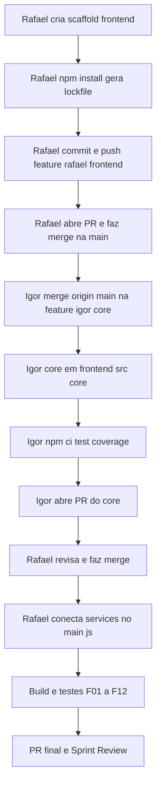

# Plano — Sprint 1 (parte do Rafael) · MoveCode

Referência base: [guia_rafael_movecode_sprint1.md](../guia_rafael_movecode_sprint1.md:1)

## Decisões de layout (acordadas com o time)

- Projeto Vite **dentro de** `oficina-de-integracao-2/frontend/` (raiz do projeto frontend).
- `oficina-de-integracao-2/backend/` fica separado (Sprint 2 / Igor).
- Núcleo do Igor vai em `oficina-de-integracao-2/frontend/src/core/`:
  - `interpreter.js` → exporta `parseProgram(source)` (contrato §6.5 do guia).
  - `engine.js` → exporta `executeProgram(instructions, challenge)`.
  - testes: `src/core/**/*.test.js` (hoje em `frontend/src/core/tests/`, já coberto pelo `include: ["src/**/*.test.js"]`).
- Divisão de arquivos para evitar conflito no Git:
  - **Igor** altera apenas `frontend/src/core/**`.
  - **Rafael** altera todo o restante.
- `.gitignore` e `.nvmrc` na **raiz** do repo `oficina-de-integracao-2/` (cobrem `frontend/` e `backend/`).

## Ordem de entrega (crítica)

O scaffold do frontend deve ser publicado/mergeado na `main` **antes** de o Igor rodar testes, pois o guia proíbe o Igor de criar/alterar `package.json`.



## Pontos de PARADA (avisar o Rafael antes de prosseguir)

- **PARADA 1 — antes de qualquer commit**: confirmar 100% do que será commitado (`git status`/`git diff`), ambiente Node/Git e versões npm válidas.
- **PARADA 2 — antes da integração**: confirmar que o Igor fez merge da `main` na `feature/igor-core` e entregou `frontend/src/core/` (interpreter.js, engine.js).
- **PARADA 3 — antes do merge final**: validar `npm ci`, `npm run test` verde e `npm run coverage` ≥ 80% em `interpreter.js` e `engine.js`.

## Riscos / verificações

- **Versões do guia** podem não existir no registro npm (`vite@8.3.4`, `vitest@5.0.4`, `@vitest/coverage-v8@5.0.4`, Node `24.22.0`).
  Verificar antes: `npm view vite version`, `npm view vitest version`, `npm view @vitest/coverage-v8 version`.
  Se não existirem, usar a última estável e fixar exato (`--save-exact`).
- **Sem terminal nesta sessão**: `npm install`, `git` e `gh` são executados pelo Rafael. Este plano entrega os arquivos e os comandos prontos.

---

## Comandos (executar dentro de `oficina-de-integracao-2/`)

Verificação de ambiente:

```powershell
node -v
npm -v
git --version
npm view vite version
npm view vitest version
npm view @vitest/coverage-v8 version
```

Scaffold + dependências (dentro de `frontend/`):

```powershell
cd frontend
npm install --save-dev --save-exact vite@8.3.4 vitest@5.0.4 @vitest/coverage-v8@5.0.4
npm install
npm run build
```

Branch + primeiro commit (dentro de `oficina-de-integracao-2/`):

```powershell
git switch -c feature/rafael-frontend
git status
git add .gitignore .nvmrc frontend
git commit -m "chore(frontend): cria scaffold Vite e interface inicial do desafio"
git push -u origin feature/rafael-frontend
```

Atualizar a branch quando a `main` avançar:

```powershell
git fetch origin
git switch feature/rafael-frontend
git merge origin/main
```

## Contrato a enviar ao Igor (resumo §6.5)

- `parseProgram(source)` → válido: `{ ok: true, instructions: [{ command: "FRENTE", line: 2 }] }`; inválido: `{ ok: false, errors: [{ line: 2, message: "..." }] }` (linhas começam em 1).
- `executeProgram(instructions, challenge)` → `{ ok, completed, steps: [{ command, line, from, to }], finalPosition, error }`; `error` traz `line` e `message`.

---

## Issues do GitHub

Já existentes (criadas pelo Igor via `gh`): **#6, #7, #8** (igor) e **#9** (scaffold rafael).
Não duplicar. As duas issues do Rafael abaixo ainda precisam ser criadas.

### Issue A — label `rafael` — Tela do desafio, cenário, personagem e editor

Entregáveis:
- `frontend/index.html`
- `frontend/src/main.js`
- `frontend/src/data/challenge.js`
- `frontend/src/ui/renderBoard.js`
- `frontend/src/ui/controller.js`
- `frontend/src/styles/style.css`

Critérios de aceite:
- Grade com posição inicial, obstáculos, objetivo e personagem.
- Lista dos comandos disponíveis.
- Editor Portugol com o programa inicial de exemplo.
- Botões "Executar programa" e "Reiniciar cenário" ligados ao controlador.
- Mensagens de resultado e registro dos passos.
- Layout revisado em desktop e tela estreita.
- Sem duplicar regras do interpretador/motor.

Referência: Etapas 4 e 5 do guia.

### Issue B — label `rafael` — Integração do front-end com o núcleo e README final

Depende de: #6 (interpretador) e #7 (motor).

Entregáveis:
- Atualizar `frontend/src/main.js` para importar `parseProgram` de `./core/interpreter.js` e `executeProgram` de `./core/engine.js` (remover `services: null`).
- Validar os fluxos F01–F12 no navegador com o núcleo integrado.
- README final com instalação, execução, testes e cobertura.

Critérios de aceite:
- `npm ci` e `npm run build` sem erros.
- `npm run test` verde e `npm run coverage` ≥ 80% em `src/core/**`.
- Erros de sintaxe e de movimento apresentados corretamente.
- Sem duplicar as regras do núcleo.

Referência: Etapas 6.6–6.8 e 7 do guia.

Comandos (gh autenticado):

```powershell
gh issue create --title "Tela do desafio, cenário, personagem e editor" --label rafael --body "Ver plans/sprint1-rafael-plano.md (Issue A)"
gh issue create --title "Integração do front-end com o núcleo e README final" --label rafael --body "Depende de #6 e #7. Ver plans/sprint1-rafael-plano.md (Issue B)"
```
